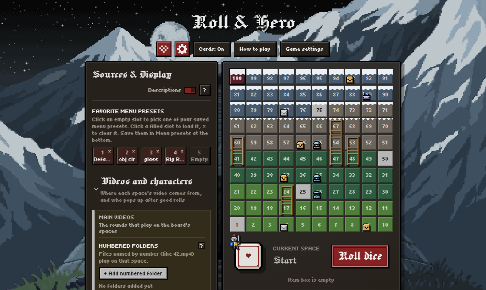

# Roll & Hero

A dice-board video game. Roll the die, move your knight across 100 spaces, and every space you land on plays one of **your own videos**. Reach space 100 to win the run.

**[Download the latest release (Windows and Linux)](https://github.com/xurby/roll-and-hero/releases/latest)**



## Features

- **Your videos on the board:** numbered folders (`42.mp4` plays on space 42), unnumbered folders sorted by length and/or BPM, and handpicked videos you drag onto exact spaces. Zip files work too.
- **Special videos:**
  - **Checkpoint videos:** special videos on spaces 1, 25, 50, 75 and 100.
  - **Invasions:** clips that cut into a round, then the round picks up where it stopped.
  - **Side quests:** optional quest videos on the board. Finish one to win its reward item.
  - **Merchant:** offers 2 cards. Pick one and watch one extra video to get it.
  - **Reward videos:** play after you win.
  - **Cards:** every 25 spaces you pick 1 of 3 items (Fly Swatter, Hand Slipped, Magic Watch, Fast Forward, 9 Sided Dice and more).
- **Map objects:** placed randomly or saved in presets. Hover a space to see its videos and what's on it.
  - **Ladders:** climb 1 or 2 rows by watching the videos on the way.
  - **Chests:** open one for a random card, or an invasion.
  - **Merchants:** pick 1 of 2 cards and watch one extra video to get it.
  - **Wells:** rest 10 seconds, but you might fall to the row below.
  - **Letters:** choose 1 of up to 3 side quests you haven't done this run.
  - **Altars:** play 4 random rounds to pick any card in the game.
  - **Towers:** play one side quest.
- **Heroes:** seven knights with their own powers, from Ruiner's one-time "Ruined!" revive to Royal's 7-sided die. Most have to be unlocked by playing.
- **Modifiers:** speed-ups, slow-downs, bursts and repeating captions.
- **Display settings:** an 8-bit style (or the normal one), board size, and records like Longest Stretch, Marathon and Screen Time. A pixel-art landscape sits behind the board (meadow, forest, rock and tower sections, a moon and optional snow), colored from your own colors, or use your own picture. Darken it, and darken it further while a video plays. Color each board section, the checkpoints, objects, snow, ladders (wooden or rope) and more, with optional opacity sliders. Built-in color presets include Nightfall and Autumn.
- **Even video volume:** every video's loudness is measured (silence ignored) and brought to the same level, with a limiter that catches sudden loud spikes, so quiet and loud videos sound alike. Each video's level is remembered, and **Measure all videos now** works them all out ahead of time. It can be turned off with **Even out video volume** in the **Sound** menu.
- **Turns and saving:** a wait between rolls with optional auto roll, and come back at your last checkpoint or on the exact space you left.
- **Presets:** save, export and import both menu and game settings, or copy and paste them as text.

## Download

The apps are in the [`releases`](releases) folder of this repository (and on the [Releases](../../releases) page):

- **Windows:** [`RollAndHero-Windows.7z`](releases/RollAndHero-Windows.7z). On an up-to-date Windows 11, right-click it → **Extract All**. On Windows 10 (or if that option is missing), open it with [7-Zip](https://www.7-zip.org/). Then run `roll-and-hero.exe` in the extracted folder. Windows may say "Windows protected your PC" because the app isn't signed. Click **More info → Run anyway**.
- **Linux:** [`RollAndHero-Linux.tar.xz`](releases/RollAndHero-Linux.tar.xz). Extract it (`tar -xf RollAndHero-Linux.tar.xz`) and run `./start-roll-and-hero.sh`.

You can also play without installing anything: open `index.html` in Chrome or Edge. Those browsers can remember your video folders between visits.

## Getting started

1. Open the **cog** menu and add your video folders under **Videos and characters**. In the desktop app, **Select folders…** opens the Windows folder dialog so you can pick several folders at once (Ctrl or Shift + click), and **Add every folder inside a folder…** adds all the folders inside one (for example a `Rounds` folder). Folders picked this way open again by themselves the next time you start the app.
2. Choose how the game plays in **Game settings**, or load one of its presets.
3. Press **Roll dice** (or `R`).

Keys: `R` roll · `Z` accept · `X` decline · `1`–`5` items · `Space` I lost (or I win! during a reward video).

The **How to play** button and the **?** buttons in the menus explain everything else.

## Ready-made packs

You can share the game together with its videos as one folder. Put the app and the video folders in the same folder (or the app one level down), and add a `roll-and-hero-pack.json` next to the app that says which folder is what:

```json
{
  "id": "my-pack",
  "version": 1,
  "characters": ["Characters"],
  "numbered": ["Numbered"],
  "unnumbered": [{ "name": "Rounds", "folders": ["Rounds/Easy", "Rounds/Hard"], "sortBy": "length" }],
  "checkpoints": ["Checkpoints"],
  "invasion": ["Invasions"],
  "merchant": "Merchant",
  "reward": "Rewards",
  "sidequests": "Side quests"
}
```

Paths are relative to the folder that holds the `.json`, and every entry is optional. `sortBy` is `length`, `bpm` or `mix` (with `mixWeight` from 0 = BPM only to 100 = length only). The first time the app starts from the pack it adds all of these folders by itself; raise `version` to set it up again. A pack keeps its own settings, so it never mixes with another copy of the game on the same PC.

## Project layout

| Path | What it is |
|---|---|
| `index.html` | The whole game: one self-contained page (HTML, CSS and JavaScript, fonts included) |
| `main.js` | The desktop app's window (Electron): the folder dialog, reading picked folders by path, and ready-made packs |
| `preload.js` | Lets the page go fullscreen while a video plays, pick several folders at once, and read them |
| `assets/` | App icons |
| `packaging/` | The Linux launcher and the README files that go inside the downloads |
| `releases/` | The built Windows and Linux apps |
| `scripts/build.sh` | Builds both apps into `releases/` |
| `scripts/pack7z.py` | Packs the Windows app into a small `.7z` |
| `.github/workflows/build.yml` | Builds the apps on GitHub and attaches them to releases |

## Development

You'll need [Node.js](https://nodejs.org/) 20 or newer, and Python 3 with `py7zr` (`pip install py7zr`) to build the apps.

```sh
npm install        # once
npm start          # run the desktop app from the source
npm run build      # build releases/RollAndHero-Windows.7z and releases/RollAndHero-Linux.tar.xz
```

`npm run build` runs `scripts/build.sh`, so it needs a shell with `tar` and `xz`: Linux, macOS or WSL. Both apps are built from any of these, and building the Windows app doesn't need Wine. Packing takes a few minutes because it uses the strongest compression.

**Keeping the apps under GitHub's 100 MB limit:** the Windows app is packed as `.7z` and the Linux app as `.tar.xz`, which are much smaller than `.zip` and `.tar.gz`. The Windows app also leaves out WebGPU's shader compiler (`dxcompiler.dll`, `dxil.dll`), which the game doesn't use, and only English and Spanish menus are kept. Electron is pinned to one version, because newer ones can be bigger; the build stops with an error if a file ends up over the limit. Each new build you commit adds about 180 MB to the repository's history, so commit `releases/` only when you publish a new version.

To make changes to the game itself, edit `index.html`. You can test it straight in a browser, with no build step.

## Releases

GitHub Actions builds both apps on every push to `main` and keeps them as a downloadable artifact on the workflow run. To publish a release, push a version tag:

```sh
git tag v1.0.0
git push origin v1.0.0
```

The workflow then builds both apps again and attaches `RollAndHero-Windows.7z` and `RollAndHero-Linux.tar.xz` to a GitHub Release for that tag.

## License

[MIT](LICENSE). The fonts embedded in `index.html` (Press Start 2P, Tiny5, Fraunces, IBM Plex Sans and IBM Plex Mono) are under the SIL Open Font License.
